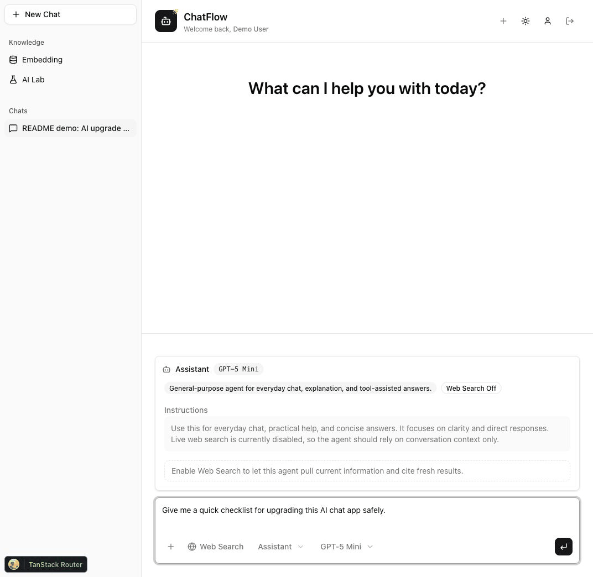

# Chat App

AI chat application built with a Bun workspace, React client, Hono API, PostgreSQL, Redis, and the AI SDK.




## Overview

The repo is organized as a Bun workspace with three packages:

- `client/` - React app built with Vite and TanStack Router
- `server/` - Hono API, auth, AI streaming, and database code
- `shared/` - shared schemas, model metadata, tool definitions, and UI message types

The repo also includes a Helm chart under `helm/chat-app/` and helper scripts for local Kubernetes workflows.

See [dependency maintenance](docs/supply-chain.md) for upgrade constraints and [Kubernetes operations](k8s/README.md) for deployment and rollback guidance.

## Features

- Streaming chat responses through the AI SDK
- Cookie-based auth for register, login, logout, and current user
- Persistent conversations in PostgreSQL
- Shared Zod schemas and TypeScript types across client and server
- Structured output endpoints for planning and LLM-as-judge evaluation
- Approval-gated web search with Serper
- File attachments in chat input
- Mermaid rendering loaded lazily for markdown diagrams
- Optional Langfuse telemetry through OpenTelemetry
- Optional Sentry monitoring for client, server, and AI SDK operations
- Docker Compose and local Kubernetes workflows

## Stack

- Runtime and package manager: Bun
- Frontend: React 19, Vite, TanStack Router, TanStack Query, Tailwind CSS
- Backend: Hono, Drizzle ORM, Zod, OpenAPI metadata
- AI: AI SDK through Vercel AI Gateway, Langfuse telemetry
- Data: PostgreSQL, Redis
- Infra: Docker, Nginx, Traefik, Helm, Kubernetes Gateway API

## Repository Layout

```text
client/                 React client
server/                 Hono API and database code
shared/                 Shared contracts and AI/tool definitions
helm/chat-app/          Helm chart
scripts/                Local deployment and setup helpers
compose.yml             Docker Compose stack
Dockerfile              Client and server production images
Makefile                Common local, Docker, and Kubernetes commands
docs/                   Architecture, security, eval, and policy docs
```

## Prerequisites

- Bun `1.4.4` (matches CI and the production runtime)
- Node.js `24.22.1` LTS on `PATH` for Vitest/jsdom and browser tooling (`nvm use` reads `.nvmrc`; supported alternatives: `22.22.2+`, `24.15.0+`, or `26+`)
- Docker Desktop or OrbStack
- `kubectl` within one minor version of the cluster server, plus Helm `4.3.1`, for Kubernetes workflows
- Vercel AI Gateway API key

Optional:

- Serper API key for web search
- Langfuse keys for telemetry
- GitHub OAuth credentials for the GitHub login provider

## Setup

Create a local `.env`:

```bash
make setup
```

Make targets default to the repo-root `.env`. Select another file consistently for setup, validation, Compose, Kubernetes helpers, and local development with `make ENV_FILE=.env.local <target>`.

Compose health checks and printed URLs use `DOMAIN` from that file. Set `DOCKER_APP_URL` to override the base URL when needed.

Then edit `.env`. At minimum set:

```text
AI_GATEWAY_API_KEY=
BETTER_AUTH_SECRET=
DB_PASSWORD=
```

For GitHub login:

```text
GITHUB_CLIENT_ID=
GITHUB_CLIENT_SECRET=
```

For Docker or Kubernetes, set `CLIENT_URL` or `BETTER_AUTH_URL` to the public app origin used by the browser, for example `https://localhost` or `https://app.docker.localhost`.

For web search:

```text
SERPER_API_KEY=
```

For Langfuse:

```text
LANGFUSE_PUBLIC_KEY=
LANGFUSE_SECRET_KEY=
LANGFUSE_BASE_URL=https://cloud.langfuse.com
```

Validate the required values:

```bash
make validate
```

## Local Development

Install dependencies:

```bash
bun ci
```

Run the client and server directly:

```bash
make local
```

Press Ctrl+C or run `make local-stop` to stop both workspace process trees. The supervisor records project ownership and process identity before allowing a later stop command to signal it.

Or start the Bun workspace dev scripts from the root:

```bash
bun run dev
```

Default local URLs:

- Client: `http://localhost:5173`
- Server: `http://localhost:3000`

Useful checks:

```bash
bun run lint
bun run typecheck
bun run test
bun run security:check
bun run build
bun run check:deploy
```

Or run the combined check:

```bash
bun run check
```

Database schema changes use the server workspace commands:

```bash
bun run --filter @chat-app/server db:generate
bun run --filter @chat-app/server db:migrate
bun run check:migrations
```

Keep generated migration history committed; application startup does not run migrations.

## Docker

The Compose stack uses current public upstream images (Bun 1.4.4, Nginx 1.31.8, Traefik 3.7.16, pgvector 0.8.7 on PostgreSQL 18, Redis 8.10.3, and Docker Socket Proxy 0.5.0). Bun, Nginx, Traefik, PostgreSQL, and Redis defaults include reviewed immutable digests. Production can override `DOCKER_SOCKET_PROXY_IMAGE`, `BUN_DEV_IMAGE`, `BUN_RUNTIME_IMAGE`, `NGINX_IMAGE`, `TRAEFIK_IMAGE`, `POSTGRES_IMAGE`, and `REDIS_IMAGE` with reviewed, digest-pinned images. `bun run check:toolchain` verifies that the selected Bun runtime, type packages, CI, Docker builds, Compose, and the root environment example agree before running the deployment checks.

Compose uses the official Nginx entrypoint and a writable, temporary `/etc/nginx/conf.d` to render `BASE_API_SLUG`, `SERVER_HOST`, and `SERVER_PORT` at startup. Nginx request variables are preserved by an explicit substitution filter. Compose Nginx overrides must provide `/docker-entrypoint.sh` and its template support. Kubernetes starts Nginx directly with a chart-rendered ConfigMap, which also supports shell-less image overrides.

CI checks both Nginx startup modes and probes the compiled server's health and readiness in a non-root, read-only container with networking disabled. Run `bun run check:client-container <image>` and `bun run check:server-container <image>` after building custom images. The server smoke check uses dummy credentials and does not exercise database, Redis, or provider connectivity.

Start the full local stack:

```bash
make start
```

This starts the configured container runtime when possible, rebuilds the application images, and waits for every service plus both public health routes before returning. The stack includes Traefik, its private read-only Docker API proxy, PostgreSQL, Redis, the migration job, API server, and client. Traefik never mounts the host Docker socket directly; the proxy exposes only container discovery, network discovery, events, ping, and version reads on an internal-only network. Discovery is limited by the project-owned `com.chatapp.traefik.scope=edge` label because Traefik reserves `traefik.*` labels for routing configuration. Outbound version and anonymous-usage checks are disabled because releases are pinned and reviewed explicitly.
Traefik 3.7's stricter encoded-path protections remain enabled. Relax `encodeQuerySemicolons`, `sanitizePath`, or encoded-character handling only for a backend with a verified RFC 3986 compatibility requirement and matching route tests.
The server image compiles the Hono entrypoint and its observability preload during the Docker build with `bun run --filter @chat-app/server build`, then starts `dist/index.js` with `dist/instrumentation.js` preloaded. Sentry's Bun build plugin instruments Hono during compilation, while the preload initializes Sentry before the transformed Hono module loads; production startup does not execute TypeScript source.

Useful commands:

```bash
make status
make logs
make health
make stop
make clean
```

`make clean` removes recreatable application resources, local app images, project-owned development processes, and generated build/test output. It preserves installed dependencies, the tracked route tree, Docker named volumes, Kubernetes PVCs, shared ingress controllers, namespaces, and the local Kubernetes runtime. Use `make clean-dependencies` separately to remove installed packages, then reinstall with `bun ci`. Data deletion is explicit: use `make docker-destroy-data CONFIRM=chat-app` or `make k8s-destroy-data CONFIRM=chat-app` only after taking any required backup.

URLs:

- App: `https://localhost`
- App/Nginx health: `https://localhost/health`
- API health through the proxy: `https://localhost/api/health`
- Langfuse Cloud: `https://cloud.langfuse.com`

Validate the Docker and deployment configuration without starting the stack:

```bash
docker compose config --quiet
bun run check:deploy
```

## Kubernetes

The Kubernetes flow uses Helm and values generated from the repo-root `.env`.

For the full local Gateway setup with Traefik:

```bash
# K8S_GATEWAY_ENABLED=true in .env
make kubernetes
```

This will:

1. Validate `.env` and install the exact dependency graph from `bun.lock`
2. Run the complete security, lint, type, test, build, Docker, Helm, and Kubernetes CI gate
3. Install or upgrade Traefik when Gateway mode is enabled
4. Generate local Helm values and browser-trusted local TLS when `mkcert` is available
5. Build the server, client, and migration images
6. Deploy the app chart
7. Run database migrations
8. Run rollout, Helm, and external health smoke tests
9. Print status and URLs

Useful commands:

```bash
make k8s-full-stack
make k8s-status
make k8s-logs
make k8s-cleanup
make k8s-stop
```

The chart renders client/server Deployments, PostgreSQL and Redis StatefulSets, a migration Job, Services, NetworkPolicies, HPA, PDB, probes, optional Gateway API HTTPRoutes, and optional Traefik Middleware CRDs. Local generated values use public Postgres/Redis images and local app images with `pullPolicy: Never`; production values can override every image by registry, tag, or digest. Production defaults reference an externally managed `chat-app-secrets` Secret and never render placeholder credentials. The server is stateless; only PostgreSQL and Redis own persistent storage.

See `helm/chat-app/README.md` for the chart contract and `k8s/README.md` for the full Kubernetes runbook.

## Bun Workspaces

Dependency versions shared across workspaces are defined in the root `catalog` field and referenced with `catalog:` from package manifests.

Use `bun ci` in CI and clean local installs. It is equivalent to a frozen-lockfile install and fails when `package.json` and `bun.lock` drift.

Dependabot uses one root Bun workspace update to keep the catalog, workspace manifests, and shared lockfile together, with a three-day cooldown matching `bunfig.toml`. Dockerfile and Compose image updates are tracked separately. CI builds the public upstream images without registry credentials. Its Bun and Nginx images are pinned to verified multi-platform digests in `.github/workflows/ci.yml`; update those digests together with their version tags.

Sonar client coverage uses `bun run --filter @chat-app/client test:coverage`, backed by Vitest and its matching V8 coverage package. Server coverage uses the server's existing Bun test script so its environment preload and concurrency settings are preserved.

TypeScript checks use Bun 1.4.4's built-in checker with each workspace's tsconfig:

```bash
bun run typecheck
```

TypeScript 7.0.2 remains installed for editors and the comparison/fallback command `bun run typecheck:tsc`, which CI also runs. At the repository root, use `bun run typecheck`: the existing `check` package script shadows bare `bun check`. Standalone client builds check types before Vite runs; server builds use `Bun.build({ check: true })`. Server development and tests also use `--check`, preserving the instrumentation/environment preloads and test isolation. `bun run check` first verifies runtime, exact Bun type requirements, resolved lockfile types, and container pins. See the [Bun 1.4.4 review](docs/supply-chain.md#bun-144-review) for the release assessment.

The repo uses Bun's isolated linker:

```toml
[install]
linker = "isolated"
minimumReleaseAge = "3d"
```

This matters for Docker. The production images copy:

- root `node_modules`, which contains Bun's `.bun` package store
- workspace `node_modules`, which contain the package-local dependency links

Without both parts, imports from `/app/server` or `/app/shared` can fail at runtime.

## AI and Tools

The server uses the AI SDK through Vercel AI Gateway for chat, structured generation, embeddings, and Jev evaluations. The model selector loads chat models from the Gateway catalog and falls back to the inexpensive `openai/gpt-5-mini` model. The API key is configured once as `AI_GATEWAY_API_KEY`.


Web search is exposed through the `serper` tool. It is approval-gated, so the UI must explicitly approve a tool call before the server continues the stream.

AI SDK telemetry is enabled when Langfuse or Sentry credentials are present. Each chat, structured generation, RAG, and embedding operation uses a stable identifier, and prompt inputs and model outputs are excluded from traces. Langfuse exports AI SDK spans through OpenTelemetry; Sentry records AI operations and explicitly captured stream failures when `SENTRY_DSN` is configured.

## Security and Operations Docs

- `SECURITY.md` - vulnerability reporting and supported security posture
- `docs/security.md` - runtime, proxy, secret, and deployment hardening notes
- `docs/supply-chain.md` - Bun/npm supply-chain policy and Shai-Hulud response playbook
- `docs/ai-architecture.md` - agent, tool, streaming, and observability architecture
- `docs/model-policy.md` - model catalog and upgrade policy
- `k8s/README.md` - Kubernetes setup, image maintenance, stateful rollout, and cleanup
- `docs/evals.md` - release evaluation checklist for AI behavior

## Common Commands

```bash
bun ci
make setup             # create .env from .env.example
make validate          # check required env vars
make local             # run client and server directly
make start             # Docker Compose stack
make stop              # stop Docker Compose stack
bun run security:check # dependency audit plus supply-chain indicator scan
make kubernetes        # one-command CI + full local Kubernetes/Gateway deployment and test
make k8s-status        # Kubernetes status and URLs
make deploy-check      # Compose + Dockerfile + Helm/Kubernetes validation
make clean             # safe cleanup; preserve Docker volumes and Kubernetes PVCs
make k8s-destroy-data CONFIRM=chat-app # intentionally delete release PVCs
make clean-generated   # remove generated local artifacts
make clean-dependencies # remove installed packages; reinstall with bun ci
bun run check          # lint, typecheck, and tests
bun run test:e2e       # desktop and mobile journeys against the production build
bun run test:integration # persistence/quota regressions; requires migrated disposable DB_URL
bun run build:report    # production build plus enforced initial/total JS bundle budgets
bun run check:ci       # audit, supply-chain scan, knip, tests, builds, deployment checks
bun run k8s:validate   # alias for the deployment checker
docker compose config --quiet
```

The bundle report follows the Vite manifest's static imports and enforces an 800 KiB initial JavaScript budget, alongside the existing total and per-file budgets. Optional Markdown, code, math, and diagram renderers retain their asynchronous loading boundaries. `BUNDLE_MAX_INITIAL_JS_KIB` can override the initial budget for an explicitly reviewed change. `check:ci` runs the same budget check after building; browser journeys also check for uncaught browser errors and exercise rich answers.

Renderer styles are scanned from the client's workspace dependencies, matching Bun's isolated linker. KaTeX styles and fonts load with the math plugin, so equations render correctly without adding math assets to the initial page load.

Follow the [dependency maintenance guide](docs/supply-chain.md) when updating packages or runtime images. It records compatibility holds, migration-image checks, and rollback requirements. The [AI evaluation guide](docs/evals.md) covers streaming, persistence, tool approvals, RAG, and live-model verification.

## Generated Files

Some files are generated by local workflows and should not be edited by hand unless you know why:

- `client/src/routeTree.gen.ts`
- `helm/chat-app/values.local.yaml`
- `k8s/traefik-values.generated.yaml`
- workspace `dist/`, `.vite/`, `coverage/`, and `*.tsbuildinfo`

To remove build/test output and local deployment values while preserving installed dependencies and the tracked route tree:

```bash
make clean-generated
```

### Jev Studio

Visit `/chat/jev` for a separate workspace to classify, score and check text or JSON with TypeSafe Jev through Vercel AI Gateway. Set the server-only `AI_GATEWAY_API_KEY` and restart the server to enable live evaluations. Templates remain available before configuration. See [Jev setup, capabilities and interpretation](docs/jev.md).

### MCP workspace

Explore connected tools, resources, and prompts in **Workspace → MCP workspace**, then use them in chat with per-action approval. Includes live discovery, capability search, schema inspection, resource/prompt previews, and user-scoped server access. See [MCP setup and rollout](docs/mcp.md) for runtime configuration and supported protocol features.
